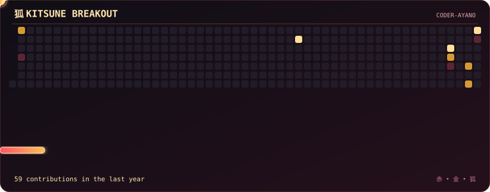

# CODER-AYANO — Manan

<div align="center">
  
  

  <h3>「静寂の中に、力を。」</h3>

  <p><i>Power in silence.</i></p>

  
  
  

  <br/>

  **Computer Science Student · Developer · Builder**

  *A problem maker. Blehh.*

  <br/>

  [**Explore my repositories →**](https://github.com/CODER-AYANO?tab=repositories)

</div>

---

## THE DEVELOPER

```yaml
username: ayano
name: Manan
role: Computer Science Student
focus:
  - Software Development
  - Data Structures & Algorithms
  - Full-Stack Applications
  - AI-Powered Tools
currently: Turning ideas into working products
philosophy: Learn. Build. Improve.
```

I'm a CSE student passionate about building useful software, experimenting with new technologies, and turning everyday problems into engineering projects.

From browser extensions to database-driven applications, I enjoy understanding how things work under the hood—not just making them work.

---

## ARSENAL

<div align="center">


</div>

---

## PROJECTS

### **[Recall](https://github.com/CODER-AYANO/Recall)**
**A smarter way to remember what you read**

A browser extension concept for extracting website content, organizing information into tagged text files, and using AI to answer questions about saved articles.

`JavaScript` `Chrome Extensions` `LLMs`

### **[Luma Wave](https://github.com/CODER-AYANO/Luma-Wave)**
**A visual experience for the desktop**

A Windows desktop visualizer project exploring a more immersive, aesthetic visual experience.

`Python` `Desktop Development` `Windows`

### **[Formly](https://github.com/CODER-AYANO/Formly)**
**AI-powered browser form autofill**

A Chrome extension that uses AI to understand web forms and automate filling relevant fields.

`JavaScript` `Chrome Extensions` `Gemini API`

<div align="center">

[**View all projects →**](https://github.com/CODER-AYANO?tab=repositories)

</div>

---

## GITHUB ACTIVITY

<div align="center">


<br>


<br><br>



</picture>

</div>

---

## THE CODE
<div align="center">

```text

   CODE  ×  COFFEE
   ────────────────
   ☕ caffeine.exe
   ⚡ creativity.cpp
   🦊 ayano.mode
```

**Brewing ideas. Compiling dreams.**

</div>

<sub>Conceptual pseudocode. The loop continues.</sub>

---

## CONNECT

<div align="center">

<a href="https://github.com/CODER-AYANO">
  
</a>

<a href="https://linkedin.com/in/manan-sharma-b6a529314">
  
</a>

<a href="https://leetcode.com/u/AYANO_KUN/">
  
</a>

<a href="mailto:edu.manansharma@gmail.com">
  
</a>

<!-- Portfolio, if you have one 
<a href="YOUR_PORTFOLIO_URL">
  
</a>
-->
<br/>

<sub>静かに作り、確実に進む。</sub>

<br/>

<sub>Build quietly. Progress relentlessly.</sub>

<br/>

<div align="center">
  
</div>


</div>
